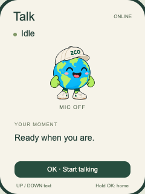
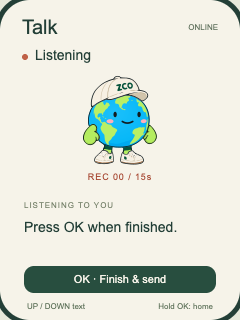
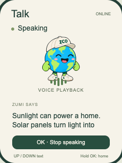
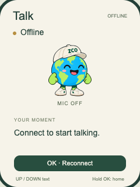
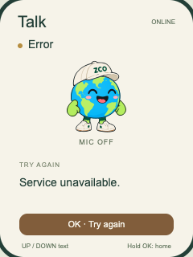

[English](zumi-talk-v1-validation.md)

> 历史阶段记录；Talk 当前接入情况见 [本地接入报告](zumi-talk-integration.zh_CN.md)。

# Talk V1.0 设计阶段测试报告

2026-10-18。本次范围为[架构与预算](zumi-talk-v1.zh_CN.md)、独立 C 状态模型、WASM 浏览器 UI，以及现有 Zumi 固件回归。没有实现或宣称生产用 Talk 音频/网络适配器。

| 项目 | 结果 | 实际证据 |
| --- | --- | --- |
| Build | PASS | ESP-IDF 5.5.3 完整官方门禁；重建现有 Zumi 固件，核验合并布局和匹配 ELF。Talk 模型另经原生 C/WASM 编译，**未链接进实体固件** |
| Host Tests | PASS | 原仓库/BSP 测试、游戏 100,000 次状态回归；Talk 六状态、ASan/UBSan 下 100,000 次转换、取消/超时边界、迟到事件、有界 UTF-8；10,000 次 Talk 原生/WASM 对比；原游戏 5,000 次对比 |
| Browser Demo | PASS | Chrome 桌面与 390×844 视口；六状态、按键开始/提交/打断、500ms 长按、恢复、固定示例识别/回答/完成、离线本地交互，无麦克风请求或外部网络请求；原 Zumi 浏览器回归通过 |
| Device Tests | NOT RUN | 未访问串口/设备，未刷写、擦除或重置 |
| Unverified | 待实现/硬件 | 可用/最大连续/最低 Heap、TLS 峰值、真实录音/ASR/LLM/TTS、协议解析/队列/排空、音频所有权、打断延迟、配网/鉴权、中文字体覆盖、LCD 可读性、电流/温升/稳定性 |

## 本次重建产物

完整门禁在 `b61f8c0` 加本次设计增量上运行。运行时源码及 `main/CMakeLists.txt` 没有变化，Talk 模型有意未加入固件链接。
内嵌版本 `b61f8c0-dirty`；应用仍为 2,006,896 字节，合并镜像 2,072,432 字节，factory 还剩 6,316,176 字节。
构建身份变化不代表已实现 Talk 传输。

- 合并镜像 SHA-256：`d3a3dee76e75f8b992bc9ec187cf076e114b7d0b05b9deeefbeef2728dd8a6d3`。
- 匹配 ELF SHA-256：`09563264221de96301e5c682da9a8d088cf664db2d0bf5690d8f21e65341d667`。
- 已复验本地归档：`build/firmware/d3a3dee76e75f8b992bc9ec187cf076e114b7d0b05b9deeefbeef2728dd8a6d3/`。
- 日志：`build/full-gate-talk-review.log`。

归档被 Git 忽略，未上传。架构审计保留上一份已核验产物身份，便于前后核对。
旧报告中的 LCD DMA 9,600 字节依据实际 40 行 BSP 更正为 19,200 字节；未修改显示驱动。

## 软件验证复现

```sh
# 已激活 ESP-IDF 5.5.3 后
./tools/validate.sh
cc -std=c11 -Wall -Wextra -Werror -fsanitize=address,undefined -Imain/zumi \
  tests/test_talk_model.c main/zumi/talk_model.c -o build/test_talk_model
build/test_talk_model
# 先把 WASI_SDK_PATH 指向已安装的 wasi-sdk 34
bash tools/build_talk_preview.sh
node tests/talk_parity.cjs
node tests/wasm_parity.cjs
# 本地 8876 服务及 Playwright/Chrome 可用时
node tests/browser_talk.cjs
node tests/browser_zumi.cjs
```

使用既有仓库根目录 8876 服务访问 `/preview/talk/`。若服务已停止，在仓库根目录运行 `python3 -m http.server 8876 --bind 127.0.0.1`。无需部署。

审计复现：`tools/audit_talk.py --archive <已核验归档> --size-report <idf-size-json>`。
使用当前 IDF 的 `tools/idf_size.py --format json2 <匹配-map>` 得到 JSON。
审计脚本核验归档、源码哈希、分区计算及实际显示缓冲常量，运行时 Heap 明确输出 null。
`tests/talk_parity.cjs` 同时检查审计运行时源码及浏览器模型源码是否仍匹配。

原生模型测试覆盖录音 15秒、处理 20秒、断流 5秒、播放总长 60秒、重连 10秒的精确边界；重连/重试不自动录音，录播不重叠，取消会话不能被迟到消息重新播放，取消/错误清文字，UTF-8 裁切保持完整字符。
畸形网络包、真实环形缓冲不属于当前模型已测范围。

## 六状态画面

以下是浏览器设计截图，不是设备照片。沿用原版 Zumi 素材，没有生成新角色。

| Idle | Listening | Processing |
| --- | --- | --- |
|  |  |  |

| Speaking | Offline | Error |
| --- | --- | --- |
|  |  |  |

浏览器结果：`build/talk-browser-results.json`、`build/talk-mobile.png`；原游戏回归：`build/browser-results.json`。
Speaking 为固定示例的播放状态模拟，不播放真实 TTS。浏览器字体不证明 LVGL 已具备中文字形。没有访问语音服务、TLS 端点或麦克风。

## 实现后、明确批准刷写后的设备验收

- 按架构定义的各阶段采样可用/最低/最大连续内部 Heap、DMA、各任务栈余量，捕获 TLS 峰值，核查暂定内存门槛与持续下降问题。
- 确认单一音频管理者，Listening 以外不采集/上传，唤醒/重连/重试不自动重启录音，不写录音或历史到 Flash。
- 验证麦克风非零样本、增益、16kHz 语速、音质、抖动与按键打断到静音延迟。有界退出，不释放/重开仍被阻塞驱动使用的资源。
- 覆盖配网/错密码/无热点、DNS 失败、无效证书、过期设备凭据、服务拒绝、畸形/超大消息、缺序、队列满、各阶段断网及取消后迟到回答。
- 确认本地尾音播完后才 DONE、15秒上限、自动超时、重连不重复提交/播放；核实服务商留存设置。
- 实测三键与长按释放防误触、屏幕裁切；选择中文时检查字形覆盖；验收原版角色和唤醒卡外观。
- 100 次会话循环与 30 分钟 Talk/游戏交替，保留六关 4×4、音效、3秒唤醒卡后原进度以及 60秒闲置熄屏。
- 实测 Idle、录音、TLS/联网、播放及熄屏整机电流，不从 Flash/Heap 数字推导续航。

以上硬件项目均未执行。审阅本次设计不需要先授权刷写或接入收费服务。
